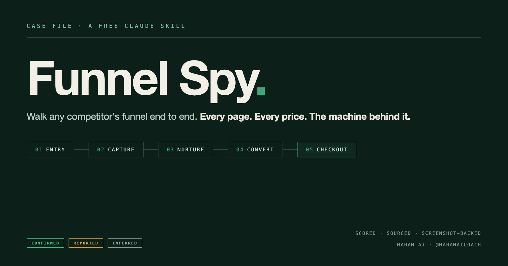

# Funnel Spy

**A free Claude skill from [Mahan Ai](https://instagram.com/mahanaicoach).**

Hand it any competitor — an Instagram/TikTok/X/LinkedIn handle, a company name, or a URL — and it **walks their sales funnel the way a stranger would**, one page at a time, and hands you the teardown:

- **The channel map** — every social platform they run, what each is *for*, the exact link each one points at, and the single page they all converge on. This is the funnel *above* the website, and it's where per-platform tracking variants (`/offer-yt` vs `/offer-ig`) give away how they attribute leads
- **Entry points** — whether they're running ads, checked in the ad libraries, not guessed
- **The Walk** — the live page-by-page path to checkout: every headline, CTA, price, proof element, and friction point, **with screenshots as evidence**
- **The Machine** — the funnel software, email platform, checkout, and tracking pixels detected from page source — and what that stack *means* (a Deadline Funnel script = evergreen scarcity; ManyChat = comment-to-DM; Calendly = sales-call close)
- **The Offer Ladder** — every rung from free to high-ticket, with prices and the gaps ("no low-ticket bridge — they jump $0 → $2,000")
- **The Scorecard** — four gates (Attract / Capture / Convert / Ascend) scored 0–100 against a fixed rubric, with the weakest gate named. Only what an outsider can verify by looking — email nurture is never scored, because it can't be seen

Then a cross-competitor synthesis: shared funnel patterns, a **Best-Engineered ranking**, and — if you tell it what *you* sell — **Your Opening** plus **Steal This Week**: three moves you can copy in days, each traceable to a page it actually walked.

Flagship output is the **Funnel Dossier** — a designed PDF that reads like a case file: the target's photo on the cover and their dossier page, the channel map, the funnel drawn as a flow diagram, the offer ladder as a staircase chart, captured copy in monospace, and clickable links straight into their ad libraries.

> Built and given away by **Mahan Ai**. If this is useful, follow [@mahanaicoach](https://instagram.com/mahanaicoach) for more Claude + automation builds.

---

## Quick start (60 seconds)

1. **Download** [`funnel-spy.skill`](funnel-spy.skill) from this repo. *(Click the file → the **Download** button.)*
2. **Open it** in the Claude desktop app and click **Save skill**.
3. In any chat, just say:

```
spy on these funnels for me: @sabrina_ramonov @thedankoe gohighlevel.com
```

That's it — you don't have to name the skill. Claude picks it up automatically.

Using **Claude Code** instead? See [INSTALL.md](INSTALL.md) for the folder-copy method.

**Want the deep dive?** [GUIDE.md](GUIDE.md) explains how the walk works and how to get the most out of it.

---

## What makes it different

Most "funnel hacking" content is someone's opinion about a screenshot. This skill actually walks the machine, and holds a quality bar while doing it:

- **It walks, it doesn't guess.** Every funnel page is loaded live and captured — headline, CTA, price, proof, friction — with a screenshot attached. Claims about pages come from the pages.
- **Ads are verified, not vibed.** Meta Ad Library and Google Ads Transparency are checked directly. An ad running 90+ days gets called what it is: a proven winner. The ads' landing URLs get walked too — they're the entrances the bio link never shows you.
- **The stack is evidence.** Page source is matched against real signatures — ClickFunnels, GoHighLevel, Kajabi, Skool, Kit, SamCart, Stripe, Deadline Funnel, ManyChat, every major pixel — and each detection comes with the strategy it implies.
- **Hidden pages get found.** `sitemap.xml`, `robots.txt`, and the Wayback Machine surface the thank-you pages, upsells, and last year's pricing that the funnel hides from strangers.
- **It reads the copy like a copywriter.** Every money page gets a structured teardown: awareness level vs. traffic temperature (the mismatch is gold), hook type, offer stack and price anchoring, guarantee strength, urgency type — including whether the countdown is evergreen automation — proof density, and the CTA read.
- **Three evidence tiers.** Every claim is **CONFIRMED** (seen first-hand, screenshot attached), **REPORTED** (self-reported/estimated, unaudited), or **INFERRED** (a reasoned guess, labeled). Nothing fabricated, ever.
- **A rubric, not vibes.** The four-gate scorecard has fixed anchors, and the funnel math runs on named benchmark ranges — always a band, never fake precision.
- **It remembers.** Every run saves a machine-readable dossier per target. Run it again next month and you get the **diff** — price moves, new funnel steps, ads switched on, score drift — instead of another snapshot.
- **It works as a mirror.** Point it at your own funnel: same walk, same rubric, and the weakest gate becomes your **Fix This Week** list, with a you-vs-field table when competitors are in the same run.

---

## Usage examples

```
spy on these funnels: @sabrina_ramonov @thedankoe gregisenberg
```

```
tear down gohighlevel's funnel — how does a stranger become a customer, are they running ads, and what stack do they use?
```

```
walk this landing page and tell me why it converts: [URL] — I sell a $497 course, where's my opening?
```

```
spy on my own funnel too: mysite.com — where am I leaking?
```

The skill asks one question up front (format, depth, and what you sell), then researches in parallel, walks each funnel, and delivers. Run it again a month later and it hands you the diff.

---

## What you get

For **each competitor**: the walk log with screenshots, entry points + ads intel, the detected stack with a strategy read, the copy teardown of every money page, the offer ladder, 2–3 sourced numbers, the four-gate scorecard with the weakest gate named, a swipe file of their best hooks and CTAs, a links directory, and a confidence note — plus a `dossier.json` so the next run can diff.

Plus the **synthesis**: funnel patterns, the Best-Engineered ranking, Your Opening, and Steal This Week (or Fix This Week, when the funnel is yours).

---

## How it works

```
targets → normalize → one question (format · depth · your anchor)
        → recon agents fan out in parallel (find the doors)
        → channel map: every platform, its exit link, where they converge
        → the walk: page by page to checkout, screenshots as receipts
        → copy teardown on the money pages
        → stack + pixel detection from page source
        → ad library check → ad landing pages walked too
        → offer ladder + funnel math + four-gate scorecard
        → synthesis: ranking · your opening · steal this week
        → Funnel Dossier PDF (or chat / spreadsheet / Word)
        → dossier.json saved per target → the next run delivers the diff
```

The playbooks live in [`funnel-spy/references/`](funnel-spy/references/) — the walk protocol, the channel map, the copy-teardown framework, the tech-stack signature tables, the ads-intel checklist, the benchmark ranges, the re-spy diff system, and the dossier design system.

---

## Repo contents

| Path | What it is |
|---|---|
| [`funnel-spy.skill`](funnel-spy.skill) | The packaged skill — download this to install in the desktop app |
| [`funnel-spy/SKILL.md`](funnel-spy/SKILL.md) | The skill's brain: the step-by-step instructions Claude follows |
| [`funnel-spy/references/`](funnel-spy/references/) | Channel map, walk playbook, copy teardown, stack signatures, ads intel, benchmarks, re-spy diffs, portraits, output templates, dossier design |
| [`funnel-spy/scripts/render_dossier.py`](funnel-spy/scripts/render_dossier.py) | Draws the PDF from the run's JSON — the whole delivery step |
| [`funnel-spy/evals/evals.json`](funnel-spy/evals/evals.json) | Test cases proving the skill works on real targets |
| [`INSTALL.md`](INSTALL.md) | Detailed install for both the desktop app and Claude Code |

---

## Optional dependency

The **Funnel Dossier PDF** renders with [WeasyPrint](https://weasyprint.org/):

```bash
pip install weasyprint
```

Everything else (chat, spreadsheet, Word doc) works without it.

---

## Limitations & honesty

- Post-purchase upsells sit behind the purchase itself — they're reconstructed from sitemaps and archives and tagged by how they were found.
- Without a browser surface, the walk falls back to direct fetches — same chain and prices, no screenshots. It tells you which mode it ran in.
- Gated social metrics come back as estimates, tagged **REPORTED**.
- It reports "not found" instead of inventing — by design. That honesty is the product.

---

## The sibling skill

Funnel Spy goes **deep on the machine**. If you want the wide-angle read on a competitor — ICP, positioning, monetization, threat ranking — grab its sibling, [**Competitor X-Ray**](https://github.com/Mahanaicoach/competitor-x-ray). They're built to be run back to back: X-Ray to pick who matters, Funnel Spy to take their machine apart.

---

## License

MIT — see [LICENSE](LICENSE). Use it, fork it, ship it.

---

<div align="center">

**Made by Mahan Ai** · Follow for more Claude + automation builds → [@mahanaicoach](https://instagram.com/mahanaicoach)

</div>
